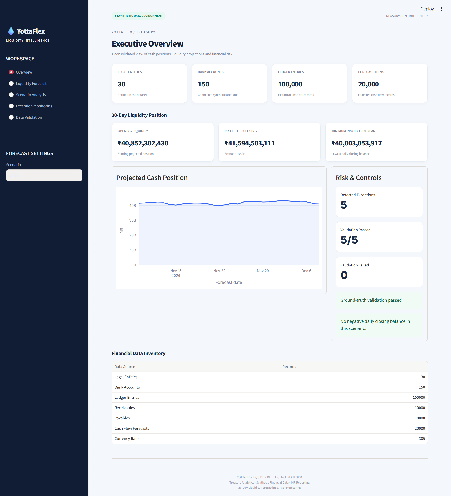
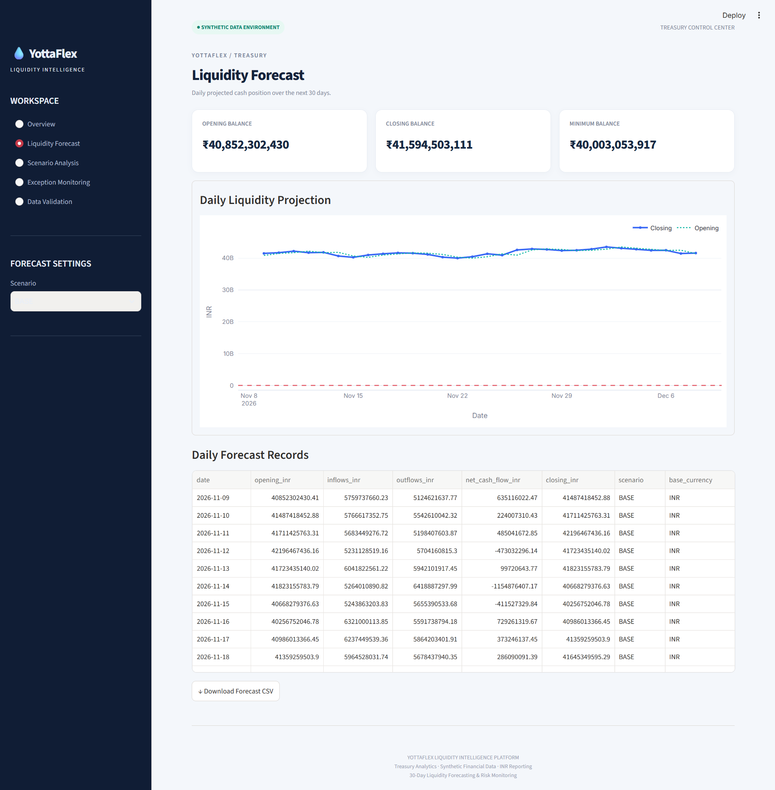
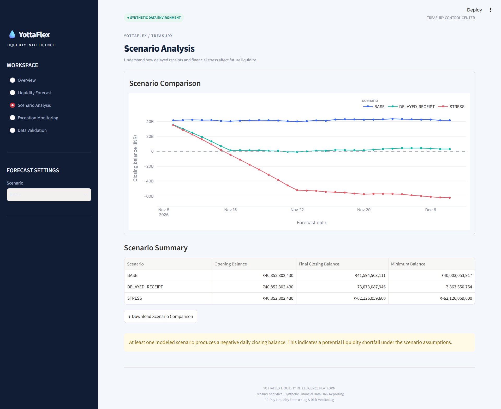
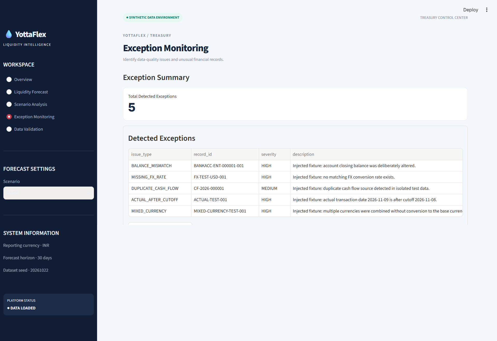
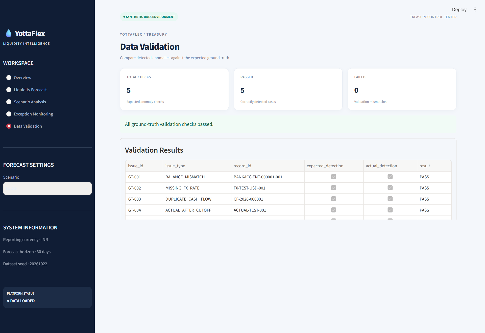

# YottaFlex – Liquidity Intelligence Platform

An AI-ready Liquidity Intelligence Platform designed to help treasury teams consolidate financial data, forecast 30-day cash positions, analyze liquidity scenarios, and detect financial data anomalies.

## Project Overview

YottaFlex provides a centralized view of financial positions using synthetic financial data, a PostgreSQL database, a FastAPI backend, and an interactive Streamlit dashboard.

## Key Features

- Financial data consolidation across legal entities and bank accounts.
- 30-day liquidity forecasting.
- Base, Delayed Receipt, and Stress scenarios.
- Multi-currency conversion into INR.
- Exception detection and monitoring.
- Ground-truth anomaly validation.
- CSV and JSON forecast exports.
- Interactive financial dashboard.

## Dashboard Preview

### Executive Overview


### Liquidity Forecast


### Scenario Analysis


### Exception Monitoring


### Data Validation


## Technology Stack

- **Backend:** Python, FastAPI
- **Database:** PostgreSQL
- **ORM:** SQLAlchemy
- **Dashboard:** Streamlit
- **Data Processing:** Pandas, NumPy
- **API Testing:** Python Requests
- **Version Control:** Git, GitHub

## Synthetic Dataset

| Data Entity | Records |
|---|---:|
| Legal Entities | 30 |
| Bank Accounts | 150 |
| Ledger Entries | 100,000 |
| Receivables | 10,000 |
| Payables | 10,000 |
| Cash Flow Forecasts | 20,000 |
| Currency Rates | 305 |
| Liquidity Scenarios | 3 |
| Forecast Runs | 3 |

**Dataset seed:** `20261022`

Generated CSV files are excluded from version control. Use the data generation script to recreate the dataset.

## Forecast Scenarios

| Scenario | Assumption |
|---|---|
| BASE | Normal expected cash flows |
| DELAYED_RECEIPT | Receipts delayed by 7 days |
| STRESS | Receipts delayed by 14 days and outflows increased by 15% |

## Project Structure

```text
yottaflex-liquidity-intelligence/
├── app/
│   ├── db.py
│   ├── forecast.py
│   ├── main.py
│   └── models.py
├── data/
│   └── anomaly_fixtures/
├── docs/
│   ├── AI_PROMPT_HISTORY.md
│   └── DATA_DICTIONARY.md
├── screenshots/
├── scripts/
│   ├── generate_data.py
│   ├── generate_anomaly_fixtures.py
│   ├── load_postgres.py
│   └── test_api.py
├── tests/
│   └── test_forecast.py
├── dashboard.py
├── requirements.txt
├── README.md
└── .env.example
```

## Installation and Setup

### 1. Clone the repository

```bash
git clone https://github.com/kumardebasis2003/yottaflex-liquidity-intelligence.git
cd yottaflex-liquidity-intelligence
```

### 2. Create a virtual environment

```bash
python -m venv .venv
```

Activate on Windows CMD:

```cmd
.venv\Scripts\activate.bat
```

### 3. Install dependencies

```bash
pip install -r requirements.txt
```

### 4. Configure environment variables

Copy `.env.example` to `.env` and configure your PostgreSQL connection.

Never commit your `.env` file or database credentials.

### 5. Generate synthetic data

```bash
python scripts/generate_data.py --scale full --seed 20261022
```

### 6. Load data into PostgreSQL

```bash
python scripts/load_postgres.py
```

### 7. Start the FastAPI backend

```bash
uvicorn app.main:app --reload --host 127.0.0.1 --port 8000
```

API documentation:

http://127.0.0.1:8000/docs

### 8. Start the Streamlit dashboard

Open another terminal:

```bash
streamlit run dashboard.py
```

Dashboard:

http://localhost:8501

## API Endpoints

| Endpoint | Description |
|---|---|
| `/health` | Health check |
| `/api/v1/summary` | Financial data summary |
| `/api/v1/forecast` | Liquidity forecast |
| `/api/v1/forecast/export.csv` | CSV forecast export |
| `/api/v1/forecast/export.json` | JSON forecast export |
| `/api/v1/exceptions` | Exception detection |
| `/api/v1/exceptions/export.csv` | Exception CSV export |
| `/api/v1/validation` | Ground-truth validation |

## Testing

Run API tests:

```bash
python scripts/test_api.py
```

Latest verification:

- API tests passed: **12**
- API tests failed: **0**
- Ground-truth validation: **5/5 passed**

## Documentation

- [Data Dictionary](docs/DATA_DICTIONARY.md)
- [AI Prompt History](docs/AI_PROMPT_HISTORY.md)

## Important Notes

- This project uses synthetic financial data.
- Forecasts are scenario-based model outputs, not actual banking predictions.
- Stress scenario negative balances represent modeled liquidity shortfalls.
- Generated datasets can be reproduced using the supplied generation script.

## Author

**Debasis Kumar Ghadai**

GitHub: [@kumardebasis2003](https://github.com/kumardebasis2003)

---

*YottaFlex Liquidity Intelligence Platform – Treasury Analytics, Cash Forecasting and Risk Monitoring.*
